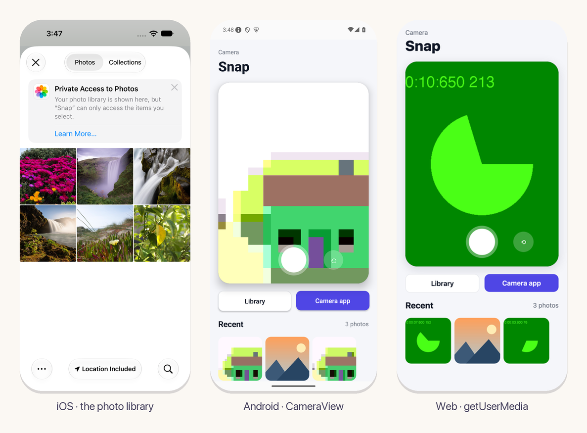

<p align="center">
  
</p>

<h2 align="center">camera</h2>
<p align="center">Photos for apps on eskiu-lang/ui: the library, the camera and a live view.</p>
<p align="center"><sub>Part of the <a href="https://github.com/eskiu-lang">Eskiu</a> project</sub></p>
<p align="center">
  <a href="https://eskiu-lang.org/ui.html">eskiu-lang.org/ui</a> &nbsp;&middot;&nbsp;
  <a href="#use-it">Use it</a> &nbsp;&middot;&nbsp;
  <a href="examples/snap">Example</a> &nbsp;&middot;&nbsp;
  <a href="https://github.com/eskiu-lang/ui">ui</a>
</p>

<p align="center">
  <a href="https://github.com/eskiu-lang/ui-camera/actions/workflows/ci.yml"></a>
  
  <a href="LICENSE"></a>
</p>

---

An app picks a photo from the library, takes one with the system's camera, or shows the camera
live in a `CameraView` and captures what it shows. Each photo comes back as a JPEG file that
`Image` shows: upright, at most 2048 pixels on its longer side, in the app's cache directory
(a `blob:` URL on the web).



## Add it

In an app made with `ui new`:

```bash
eskiuc add camera --git https://github.com/eskiu-lang/ui-camera --rev v0.1.2
```

Its `ui.toml` brings AVFoundation and PhotosUI with a camera usage text on iOS, and the camera
permission on Android. Put your own text in the app's `ui.toml`, which wins over the package's:

```toml
[ios.plist]
NSCameraUsageDescription = "Scans the receipts you add"
```

## Use it

```eskiu
import <camera>;

List<String> photos;

void Shoot() {
    Column(Style{padding: 20, gap: 12}) {
        use_photos(void(Photo photo) {
            if (photo.status != PhotoReady) { return; }
            String path;
            String_from(&path, photo.path);   // borrowed for the call: keep a copy
            photos.push(path);
        });
        CameraView(Style{height: 360, radius: 20}, false);
        Button("Take a photo") { camera_capture(); }
        Button("Choose from the library") { camera_pick_photo(); }
    }
}
```

| Name | What it is |
|---|---|
| `use_photos(fn(Photo))` | Each photo, or failure, that a picker, the camera or a capture hands back while the scope is mounted. Mount one per screen. |
| `Photo` | `status`, and when it is `PhotoReady` the file's `path` (borrowed for the call), `width` and `height` in pixels. |
| `PhotoStatus` | `PhotoReady`, `PhotoCancelled`, `PhotoDenied` (no camera permission), `PhotoUnavailable` (no camera, as on a simulator) or `PhotoFailed`. |
| `camera_pick_photo()` | The system's photo picker; it needs no permission. |
| `camera_take_photo()` | The system's camera app. |
| `CameraView(Style, bool front)` | The camera, live, filling its box (cropped): the back camera, or the front one. The first one mounted asks for the camera permission. |
| `camera_capture()` | What the mounted `CameraView` shows now, as a photo. |

## Platforms

| Platform | Library | Camera | Live view |
|---|---|---|---|
| iOS | `PHPickerViewController` | `UIImagePickerController` | `AVCaptureSession` and `AVCapturePhotoOutput` |
| Android | The photo picker (`ACTION_PICK_IMAGES`, Android 13+), else `ACTION_GET_CONTENT` | `ACTION_IMAGE_CAPTURE` into a MediaStore entry the package deletes after (Android 10+) | Camera2 into a `TextureView`, closed while the app is in the background |
| Web | A file input | A file input with `capture` (phones open the camera; desktops choose a file) | `getUserMedia` into a `<video>` |

The simulator has no camera: `CameraView` and `camera_take_photo` give `PhotoUnavailable`
there, and the library works. The Android emulator's virtual camera works.

## The example

`examples/snap` shows the camera in a card with its shutter and a switch between cameras, the
library and the camera app, and the photos taken:

```bash
cd examples/snap
ui run android    # or ios, web
```

## Tests

`eskiuc test` runs `tests/camera.esk` on this computer, with stand-ins for the platform's side:
each call reaching it, photos with paths that have spaces and with `blob:` URLs, each failure,
a malformed message, and no handler after the screen unmounts.

## License

MIT
